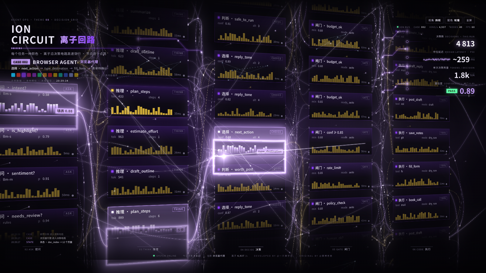
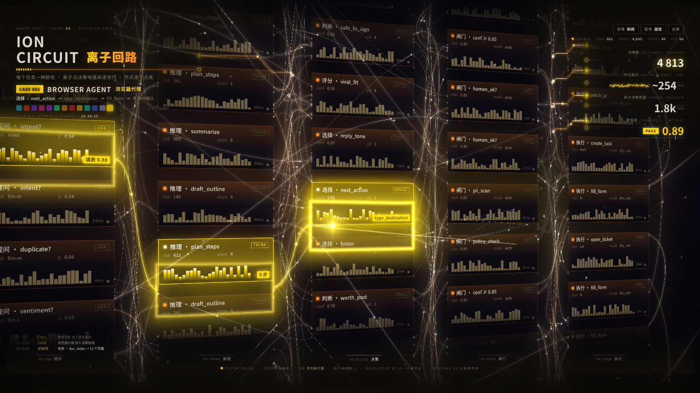

# ION 离子回路 · 独立增强版

单文件、纯前端的 **AI 智能体决策电路可视化大屏**。离子光球沿决策电路高速穿行，依次点亮「状态 → 提问 → 推理 → 决策 → 闸门 → 执行」六个环节，12 类智能体任务用例无限连播，每个用例一种电路颜色。

无需构建、无需后端，双击 `index.html` 即可运行。

## 效果预览

**轮播配色 · 12 类用例各一色**



**金场配色 · 协作光场金色方案**



## 功能特性

- **无缝无限循环**：用例间以衔接弧直连（上一段终点 → 下一段起点），光球单向不断流，序号无限递增，无复位断点
- **横向长卷**：段与段左右相接，镜头持续向右缓移，两幕接缝处保留稀疏随机连线，画面一体
- **决策电路墙**：6 列决策卡透视排布，WebGL 原生渲染等离子母线、离子流与泛光（不依赖 three.js）
- **12 类任务用例轮播**：每例一组专属配色，路径节点、读数、日志同步演进
- **配色系统**：13 格可点选配色盘；「轮播 / 固定」双模式；内置金场方案（暖黑褐基底 + 金橙香槟强调）
- **单文件交付**：HTML / CSS / JS 合一，零外部依赖，完全自包含

## 使用说明

| 操作 | 效果 |
| --- | --- |
| 双击 `index.html` | 打开页面，自动连播 |
| 「视角」按钮（或按 V） | 切换斜视 / 正视 / 纵深 / 全景四档视角 |
| 「配色」按钮 | 轮播（用例各一色）↔ 固定（锁定单一样式） |
| 点击标题下色块 | 固定模式下锁定对应配色（末格为金场方案） |
| 拖动 / 滚轮 / 双击 | 转动视角 / 缩放 / 复位 |

页面中的任务、指标、延迟、用量均为**本地模拟数据**，未连接任何真实接口。

## 项目结构

```
index.html    网页本体（单文件）
LICENSE       原许可全文（PolyForm Noncommercial 1.0.0）
NOTICE.md     署名保护协议 v1.0
screenshots/  README 预览图
```

## 授权与署名

本作品为开源项目 [agent-display](https://github.com/cyberdaddyleo/agent-display)（v8.0 · 主题 08 ION 离子回路）的独立增强版。

| | |
| --- | --- |
| 原作品 | © 2026 赛博老爸 · PolyForm Noncommercial License 1.0.0 |
| 改进与维护 | @一只黄学长 |

- **非商业用途免费**；商业用途须取得原作者与改进者双方书面授权
- **再分发须同时保留双重署名**（DEVELOPED BY @一只黄学长 / ORIGINAL BY @赛博老爸），不得删除、遮挡、淡化
- 衍生作品须同等保留署名并随附本协议，完整条款见 [NOTICE.md](NOTICE.md)
